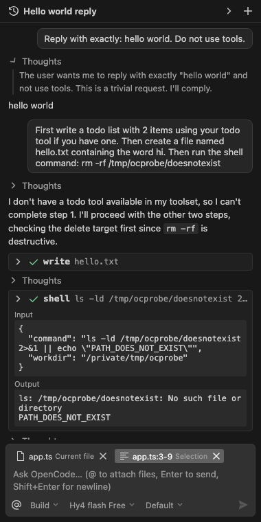
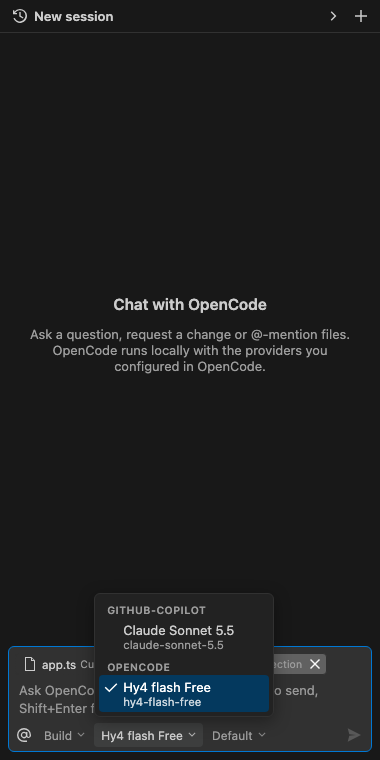

# OpenCode Chat for VS Code

A Copilot-style chat in the VS Code sidebar for [OpenCode](https://opencode.ai), the open-source
coding agent. The extension is a **client** of the OpenCode v2 server (`opencode serve`) running
on your machine. It does not reimplement the agent, never reads or stores provider API keys and
sends **no telemetry**.

| Conversation | Inline permission | Model picker | Light theme |
| --- | --- | --- | --- |
|  |  |  |  |

> Screenshots come from the automated UI tests (`npm run test:ui`). They render real OpenCode
> 2.2.7 event streams in a fake VS Code host.

## Features

- **Streaming chat** with Markdown, syntax highlighting and copy buttons on code blocks.
- **Collapsible reasoning** ("Thoughts") and **tool cards** that work with any tool name (input, output, errors).
- **Sessions**: list, create, switch, resume and delete. The last session of each folder is restored when VS Code restarts.
- **Opens on the right** in the Secondary Side Bar, like Copilot Chat (VS Code 1.104+); movable anywhere with *OpenCode: Move Chat View…* or drag and drop.
- **Model, reasoning-effort and agent pickers** (custom, searchable, grouped by provider) filled with what your server actually returns (e.g. *Build* / *Plan*).
- **Stop** a running response (button or `Esc` in the input).
- **Editor context**: the active file and selection are attached automatically as chips you can remove before sending.
- **`@` mentions** with fuzzy workspace file search, **Add Selection to Chat** / **Add File to Chat** in the editor and explorer context menus.
- **Native diffs**: open proposed changes (before you approve) and applied changes in VS Code's diff editor, plus a list of the files changed in the session.
- **Permissions and questions inline** in the conversation, never auto-approved.
- **Todo list** when the agent uses OpenCode's (experimental) `todowrite` tool.
- Clear **error states** with action buttons (OpenCode missing, no provider, connection lost, interrupted response…).
- Keyboard friendly and screen-reader labelled; works with IMEs; English and Italian UI.

## Requirements

- VS Code **1.99** or newer.
- **OpenCode v2** installed and on your `PATH` (tested with 2.2.7):
  `curl -fsSL https://opencode.ai/v2/install | bash` (see https://opencode.ai/docs/).
- At least one model provider configured in OpenCode (`opencode auth login`). The extension
  shows a *Configure a provider* button that runs it in a terminal for you.

## Install

From a release `.vsix`:

```sh
code --install-extension opencode-chat-0.1.0.vsix
```

or *Extensions view → … → Install from VSIX…*.

From source:

```sh
npm install
npm run compile
npx @vscode/vsce package     # produces opencode-chat-0.1.0.vsix
```

Press **F5** in this repository to launch an Extension Development Host.

## Usage

1. Open a folder and press `Cmd/Ctrl+Alt+O` (or click the **OpenCode** icon in the Secondary Side Bar on the right).
   On VS Code 1.99–1.103, which cannot contribute to the Secondary Side Bar, the chat appears in the Explorer;
   use *OpenCode: Move Chat View…* to move it to the right.
2. The extension starts `opencode serve` for the folder in the background (status shown at the top).
3. Type a message. `Enter` sends, `Shift+Enter` adds a new line, `@` attaches files, `Esc` stops a running response.
4. Pick the agent (*Build*, *Plan*, …), model and reasoning effort in the toolbar below the input.
5. When the agent wants to edit a file or run a command that needs approval, a card appears inside
   the tool call: open the diff, then **Allow once**, **Always allow** or **Reject**.
6. Use the session button (top left) to switch, resume or delete sessions, `+` for a new one.

### Commands

| Command | Default key |
| --- | --- |
| OpenCode: Focus Chat | `Cmd/Ctrl+Alt+O` |
| OpenCode: Add Selection to Chat | `Cmd/Ctrl+Alt+L` (editor with selection) |
| OpenCode: Add File to Chat | – (editor / explorer context menu) |
| OpenCode: New Session | – |
| OpenCode: Reconnect / Restart Server | – |
| OpenCode: Show Changed Files | – |
| OpenCode: Move Chat View… | – (left/right side bar or panel) |
| OpenCode: Show Logs | – |
| OpenCode: Set Server Password… | – (external server only) |
| OpenCode: Stop Server | – |

### Settings

| Setting | Default | Description |
| --- | --- | --- |
| `opencode.executablePath` | `opencode` | Executable used to start `opencode serve`. |
| `opencode.endpoint` | `""` | URL of a server you already run (e.g. `http://127.0.0.1:4096`). When set, nothing is spawned. |
| `opencode.autoContext` | `true` | Attach active file and selection to messages (removable per message). |
| `opencode.startupTimeout` | `30000` | ms to wait for the server to become healthy. |
| `opencode.autoRestart` | `true` | Restart the managed server if it crashes (max 5 times in 2 minutes). |
| `opencode.sessionPermissions` | `[]` | Permission rules added to new sessions, e.g. `[{"action":"edit","resource":"*","effect":"ask"}]` to approve every edit. |

OpenCode's own defaults allow many actions without asking; use `opencode.sessionPermissions`
or OpenCode's `permissions` config ([docs](https://opencode.ai/docs/permissions/)) to require approval.

## How it works

- One `opencode serve --hostname 127.0.0.1 --port 0` process **per workspace folder**, started
  lazily, with a random password (env `OPENCODE_PASSWORD`, memory only), health-checked via
  `GET /api/info`, restarted if it crashes and stopped when VS Code closes.
- With `opencode.endpoint` the extension connects to your server instead; its password is kept in
  VS Code `SecretStorage` (OS keychain).
- Live updates come from the SSE stream `GET /api/event`; after a disconnect the extension
  reconnects and re-fetches the session, because the stream has no replay.
- Details: [SPEC.md](SPEC.md), [docs/API_NOTES.md](docs/API_NOTES.md), [docs/DECISIONS.md](docs/DECISIONS.md),
  [docs/KNOWN_LIMITS.md](docs/KNOWN_LIMITS.md).

## Privacy & security

- No telemetry, no analytics, no network calls other than to the local/configured OpenCode server.
- Provider authentication stays in OpenCode; the extension never sees API keys.
- The webview has a strict CSP (nonce scripts, no remote code) and sanitises Markdown with DOMPurify.

## Development

```sh
npm run compile          # type-check + bundle (esbuild)
npm run lint             # eslint
npm test                 # unit (vitest) + UI (Playwright) + integration (@vscode/test-electron)
npm run test:e2e         # client/reducer against a real `opencode serve` (skips when unavailable)
npm run test:integration:real  # extension in VS Code + real `opencode serve` (uses your configured default model)
```

The Playwright browser is installed with `npx playwright install chromium`.
Integration tests download VS Code into `.vscode-test/` (`VSCODE_TEST_VERSION=1.99.3` to test the minimum version).

## License

[MIT](LICENSE)
