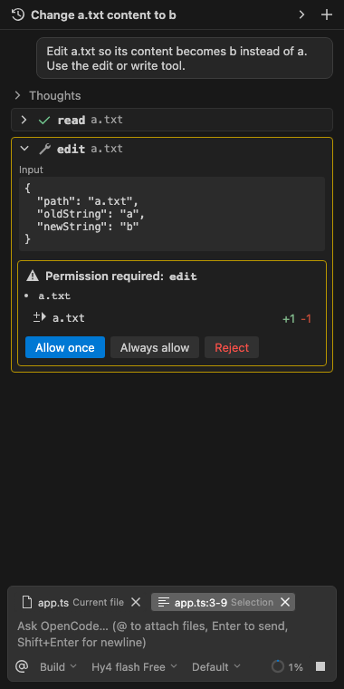
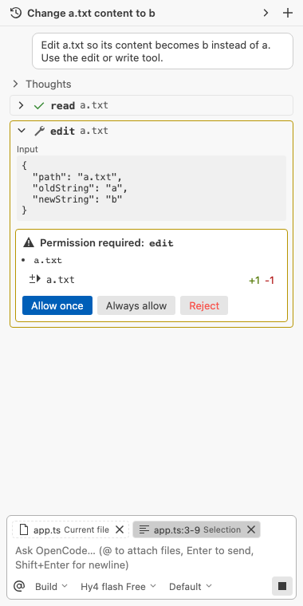

# Chat for OpenCode

[](https://github.com/mattiamalonni/chat-for-opencode/actions/workflows/ci.yml)

> **Unofficial.** This extension is a vibe-coded community project and is not affiliated with or endorsed by the OpenCode team.

A Copilot-style chat in the VS Code sidebar for [OpenCode](https://opencode.ai), the open-source
coding agent. The extension is a **client** of the OpenCode v2 server (`opencode serve`) running
on your machine. It does not reimplement the agent, never reads or stores provider API keys and
sends **no telemetry**.

| Conversation                                       | Inline permission                              | Model picker                                       | Light theme                                |
| -------------------------------------------------- | ---------------------------------------------- | -------------------------------------------------- | ------------------------------------------ |
|  |  |  |  |

> Screenshots come from the automated UI tests (`npm run test:ui`). They render recorded OpenCode
> event streams in a fake VS Code host.

## Features

- **Streaming chat** with Markdown, syntax highlighting and copy buttons on code blocks.
- **Collapsible reasoning** ("Thoughts") and **tool cards** that work with any tool name (input, output, errors).
- **Sessions**: list, create, switch, resume, rename and delete, with _Load more sessions_ for older ones and a discreet trash icon to _Delete all sessions_ (with a native VS Code confirmation) to clear the workspace at once. The last session of each folder is restored when VS Code restarts.
- **Rollback to any turn**: every prompt has a discreet _Roll back to this turn_ button. Pick the first, the last or any intermediate turn: OpenCode restores the files changed after it and removes that prompt, its reply and all later turns, while the prompt itself returns to the composer so you can edit and resend it. A native confirmation lets you keep the current files (_Messages only_).
- **Fork a turn**: the other button beside each prompt, _Fork conversation from this turn_, opens a new sibling session with the history up to that point. The current conversation and its files stay untouched, so you can try a different approach without losing the original. Forks stay visible in the session list.
- **Subagents**: live progress stays inline in the conversation. Click **Open subagent conversation** on a subagent card to inspect the child session in a read-only modal rendered with the same chat view (steps, thoughts, tools and report). Breadcrumbs navigate nested subagents and lead back to the parent chat; `Esc` or a backdrop click closes it.
- **Multi-root workspaces**: `@` searches files in every open folder (with the folder name on ambiguous matches), attachments and clickable file references work across folders, and session rows show which folder they belong to. One folder is actively connected at a time; use the folder picker in the header to switch while each folder keeps its own last session.
- **Opens on the right** in the Secondary Side Bar, like Copilot Chat (VS Code 1.104+); movable anywhere with _OpenCode: Move Chat View…_ or drag and drop.
- **Context window at a glance**: each model in the picker shows its context size, and a meter
  next to the send button shows how much of it the conversation already uses.
- **Turn stats**: when the agent finishes, one badge summarises the whole turn — the start and end
  clock times (`HH:mm`, local time) at its two ends, steps, time from your input to the last step,
  tokens summed across every step, cost when reported, and the insertions/deletions from its file
  edits. Click **+N / -N** to see all of that turn's changes in one read-only diff. The numbers come
  from OpenCode itself.
- **Model, reasoning-effort and agent pickers** (custom, searchable, grouped by provider) filled with what your server actually returns (e.g. _Build_ / _Plan_).
- **Stop** a running response (button or `Esc` in the input), and **compact** a long session from the composer toolbar or the command palette.
- **Keep working while the agent runs**: plain `Enter` queues the next message (`delivery: queue`),
  `Ctrl/Cmd+Enter` interrupts and sends it immediately (`delivery: steer`). A **Queued messages**
  panel above the composer lists the prompts still waiting in the server's inbox: promote one to
  _send now_, put it back in the composer to edit it, or remove it. A queued prompt stays in the
  panel only — it joins the conversation once the agent actually starts working on it. Composer
  drafts are stored per session **and survive a window reload**.
- A **contract smoke test** on connect names the features that a non-2.3.0 server cannot support, instead of only warning about the version number.
- **Editor context**: the active file and selection are attached automatically as chips you can remove before sending. File chips use the icons of your active VS Code file icon theme, the same as the Explorer (including dark/light/high-contrast variants and glyph fonts such as Seti).
- **`@` mentions** with fuzzy workspace file search: picking a file attaches it as a chip and removes the `@query` from the input, so only the chip is sent with the message. **Add Selection to Chat** / **Add File to Chat** in the editor and explorer context menus work the same way.
- **Context sources on demand**: type `@problems`, `@git`, `@terminal`, `@openEditors` or `@symbol`, or use the **Add context** button next to the composer's folder button. Diagnostics, the uncommitted diff, the last terminal command's output, the open editors and the symbol definitions at the cursor become removable chips whose content is sent inline to the model (no path the remote server cannot read).
- **Quick Fixes on errors**: VS Code's squiggles now offer _Fix with OpenCode_ and _Explain with OpenCode_ (up to three diagnostics at a time), which select the offending lines and prefill the chat with the diagnostic message. The editor title bar also has an **Ask OpenCode About This File** button that attaches the whole file. As with the other editor commands, nothing is sent until you press Enter.
- **Review your uncommitted work**: _OpenCode: Review My Changes_ reads the git diff of the workspace (staged + unstaged tracked files) and sends it with a review prompt; _OpenCode: Write Commit Message_ sends the same diff with a request for a Conventional Commit message you can paste into the SCM input box. Untracked files are listed by name, and diffs are capped so a huge working tree cannot flood the context.
- **Usage in the status bar**: a second, discreet item shows the session's estimated context size and cost, mirroring the composer's context meter. It updates from OpenCode's own usage events, hides when there is no data, and can be switched off with `opencode.showUsageInStatusBar`. Hover it for the input/output/cache breakdown; click to open the chat.
- **Continue in the terminal**: _OpenCode: Continue This Session in Terminal_ (also in the chat's overflow menu) opens a terminal in the workspace and runs `opencode --session <id>` for the conversation you are viewing, so you can switch between the sidebar and the TUI without losing context. With no session yet it just opens a fresh TUI. If the chat is still generating, it asks first.
- **Attach external files** by dragging them into the chat (**hold Shift**: VS Code otherwise opens the file in an editor), by pasting an image or other file into the prompt, or with the folder button, which opens a native file picker. Files outside the workspace are sent **inline** so the model receives their content instead of only a path to look for. The same applies to local files when you connect to an external `opencode.endpoint`: OpenCode reads `file:` paths from its own filesystem, which may not be yours, so their contents are embedded in the message instead.
- **Clickable file references**: `src/app.ts:42` in a reply, a tool's input path, a permission resource or a changed-file row opens the file at that line in the editor.
- **Save a reply as a project instruction**: a small action beside **Copy response** appends a dated note to `AGENTS.md` (or another Markdown file you pick inside the workspace). Duplicate notes are skipped and long replies are capped.
- **Reusable prompt library**: `/` also offers eight curated prompts (explain, tests, bugs, optimize, document, review, problems, commit) plus any prompts you define in `opencode.promptLibrary`. Picking one fills the composer with `$selection`, `$file`, `$diff` and `$problems` replaced by the current editor context — nothing is sent until you press Enter.
- **Skills**: type `/` to search skills discovered by OpenCode, including global skills; selecting one
  inserts a slash command that loads its instructions with the prompt. Known `/command` and `/skill`
  tokens are underlined like links in the input, so you can spot at a glance what OpenCode will
  interpret; an unknown `/nope` stays plain text.
- **Apply a reply's code to a file**: each code block has an **Apply to file** button. It targets the
  file referenced just above the block (or asks you to pick one), opens a native diff of the proposal
  and writes only after you press **Accept** — full-file blocks replace the file, unified diff blocks
  are applied as patches. Paths are confined to the connected workspace.
- **Native diffs**: open proposed changes (before you approve) and applied changes in VS Code's diff
  editor. The **Changed files** panel lists the session's files with per-file counts and shows the
  session totals (`+N / -N`) in its header (“1 Changed file” / “N Changed files”). Click the totals to
  open **all** the session's changes in a single read-only diff, or a file row for that file alone.
  Each row leads with the file name, followed by its parent folder in smaller text
  (`Button.tsx` `src/components/`); hover for the full path. Files at the root show only their name.
  These combined views are built from the changed hunks only and create no file on disk.
- **Permissions and questions in a dedicated panel** docked above the message box, never
  auto-approved by default — a request is always visible even if its step is folded. When several
  are pending, the newest is shown first and `Previous` / `Next` cycle through the queue. The card
  takes focus when a new request arrives; press `1`/`2`/`3` for Allow once / Always allow / Reject
  (also on a permission card you focus manually). `2` is available only when the rule can be saved.
  Reject (like
  Cancel on a question) stops the current reply; the two allow options let it continue. If the
  agent asks several questions at once, they appear one at a time with **Next question** and a
  single reply collects all the answers.
- **Todo list** when the agent uses OpenCode's (experimental) `todowrite` tool.
- **Export the conversation as Markdown** and **search messages** in the current session from the header. Matches are
  highlighted in prompts, replies and tool cards; use `Enter`/`F3` (`Shift+Enter`/`Shift+F3` backwards) or the ↑/↓
  buttons to walk them, with a live “N of M” counter. The session list has its own title filter and ↑/↓/Enter navigation.
- Clear **error states** with action buttons (OpenCode missing, no provider, connection lost, interrupted response…).
- Keyboard friendly and screen-reader labelled; works with IMEs; English UI.

## Requirements

- VS Code **1.99** or newer.
- A **trusted workspace**: the extension will not start `opencode serve`, read saved logins or use
  workspace-specific settings (`opencode.executablePath`, `opencode.endpoint`) until you trust the folder.
- **OpenCode v2** installed and on your `PATH` (contract matched to 2.3.0):
  `curl -fsSL https://opencode.ai/v2/install | bash` (see https://opencode.ai/docs/). The chat shows
  a dismissible warning if your server's minor or major version differs from the supported one.
- At least one model provider configured in OpenCode (`opencode auth login`). The extension
  shows a _Configure a provider_ button that runs it in a terminal for you.

## Install

From a release `.vsix`:

```sh
code --install-extension chat-for-opencode-<version>.vsix
```

or _Extensions view → … → Install from VSIX…_.

From source:

```sh
npm install
npm run compile
npx @vscode/vsce package     # produces chat-for-opencode-<version>.vsix
```

Press **F5** in this repository to launch an Extension Development Host.

## Usage

1. Open a folder. The chat opens automatically the first time; afterwards use `Cmd/Ctrl+Alt+O`,
   the OpenCode icon in the status bar (idle: view logins or sign in; running: stop the current
   response; **amber question mark: approval or answer needed — click to open the chat**; finished:
   open the chat), or the OpenCode icon in the Secondary Side Bar on the right. New users can also
   open **Help → Welcome → Get started with OpenCode** for a four-step setup walkthrough.
   On VS Code 1.99–1.103, which cannot contribute to the Secondary Side Bar, the chat appears in the Explorer;
   use _OpenCode: Move Chat View…_ to move it to the right.
2. In a trusted folder the extension starts `opencode serve` in the background (status shown at the top).
   In an untrusted one it shows a _Trust workspace_ action instead and starts nothing.
3. Type a message. `Enter` sends, `Shift+Enter` adds a new line, `@` suggests files, `/` suggests
   skills, and `Esc` stops a running response. Selecting a skill adds `/skill-id`; the extension
   translates it to OpenCode's `@skill-id` syntax when sending so OpenCode loads its instructions
   with your prompt.
4. Pick the agent (_Build_, _Plan_, …), model and reasoning effort in the toolbar below the input.
5. When the agent wants to edit a file or run a command that needs approval, a card appears inside
   the tool call: open the diff, then **Allow once**, **Always allow** or **Reject**.
6. Use the session button (top left) to switch, resume, rename or delete sessions. The `+` next to the header's refresh icon starts a new one; _Load more sessions_ reaches older ones, and the small trash icon next to `+ New Session` in the list deletes every session after a native VS Code confirmation.

### Skills

The `/` suggestions come from OpenCode's `GET /api/skill` catalog. OpenCode discovers project and
global skills from its [supported skill locations](https://opencode.ai/docs/skills/#discovery),
including `~/.config/opencode/skills`, `~/.agents/skills` and `~/.claude/skills`. The extension
queries the server's default location so its global skills are included. A skill directory must
contain a `SKILL.md` file (or be a root-level `.md` skill) for OpenCode to discover it.

Choose a suggestion to insert `/skill-id`; when sending, the extension converts that command to
`@skill-id`, which is OpenCode's syntax for loading a skill. Other slash commands are sent
unchanged. The extension sends only skill IDs, names and descriptions to the webview; OpenCode
loads the skill content.

### Commands

| Command                                     | Default key                                                                                   |
| ------------------------------------------- | --------------------------------------------------------------------------------------------- |
| OpenCode: Focus Chat                        | `Cmd/Ctrl+Alt+O`                                                                              |
| OpenCode: Quick Switch Session              | `Cmd/Ctrl+Alt+S` (recent sessions first; typing searches all conversations)                   |
| OpenCode: Install OpenCode…                 | – (copy the install command, open platform instructions, retry the connection)                |
| OpenCode: Ask OpenCode…                     | `Cmd/Ctrl+Alt+Shift+O` (fill the composer from anywhere, with the current selection attached) |
| OpenCode: Stop current response             | – (also click the status bar while a turn runs)                                               |
| OpenCode: Open Chat in Editor               | – (toolbar, opens a second, wider chat view)                                                  |
| OpenCode: Add Selection to Chat             | `Cmd/Ctrl+Alt+L` (editor with selection)                                                      |
| OpenCode: Add File to Chat                  | – (editor / explorer context menu)                                                            |
| OpenCode: Ask OpenCode About This File      | – (editor title button / command palette)                                                     |
| OpenCode: Fix with OpenCode                 | – (Quick Fix on a diagnostic; also the command behind the lightbulb)                          |
| OpenCode: Explain with OpenCode             | – (Quick Fix on a diagnostic)                                                                 |
| OpenCode: Review My Changes                 | – (sends the workspace git diff with a review prompt)                                         |
| OpenCode: Write Commit Message              | – (sends the workspace git diff with a Conventional Commit prompt)                            |
| OpenCode: Continue This Session in Terminal | – (chat overflow menu; `opencode --session <id>` in a terminal)                               |
| OpenCode: New Session                       | `Cmd/Ctrl+N` (chat focused)                                                                   |
| Search messages in the chat                 | `Cmd/Ctrl+F`, then `F3`/`Shift+F3` for next/previous match                                    |
| Sync the current session                    | `Cmd/Ctrl+R` (chat focused)                                                                   |
| OpenCode: Compact Conversation              | –                                                                                             |
| OpenCode: Restart Server…                   | – (toolbar, with confirmation)                                                                |
| OpenCode: Open Extension Settings           | – (toolbar gear icon)                                                                         |
| OpenCode: Move Chat View…                   | – (left/right side bar or panel)                                                              |
| OpenCode: Show Logs                         | –                                                                                             |
| OpenCode: Set Server Password…              | – (external server only)                                                                      |
| OpenCode: Stop Server                       | –                                                                                             |

### Settings

| Setting                           | Default                                    | Description                                                                                                                                                                                               |
| --------------------------------- | ------------------------------------------ | --------------------------------------------------------------------------------------------------------------------------------------------------------------------------------------------------------- |
| `opencode.executablePath`         | `opencode`                                 | Executable used to start `opencode serve`.                                                                                                                                                                |
| `opencode.endpoint`               | `""`                                       | URL of a server you already run (e.g. `http://127.0.0.1:4096`). When set, nothing is spawned.                                                                                                             |
| `opencode.autoContext`            | `true`                                     | Show the active file and selection as context chips. Selections are attached automatically; add the active file to a message with one click.                                                              |
| `opencode.startupTimeout`         | `30000`                                    | ms to wait for the server to become healthy.                                                                                                                                                              |
| `opencode.autoRestart`            | `true`                                     | Restart the managed server if it crashes (max 5 times in 2 minutes).                                                                                                                                      |
| `opencode.sessionPermissions`     | ask before edits, shell and external files | Rules added to new sessions. Set `[]` to restore OpenCode's permissive defaults.                                                                                                                          |
| `opencode.autoApprovePermissions` | `false`                                    | Default for new chats: auto-approve every permission request without showing the approval panel (granted once, saved rules untouched). The **Auto-approve** toggle in the composer overrides it per chat. |
| `opencode.sessionPageSize`        | `10`                                       | Sessions shown per page in the session list; older ones are fetched with **Load more sessions**.                                                                                                          |
| `opencode.notifyOnComplete`       | `false`                                    | Notify when a turn finishes while the chat is hidden, with an **Open chat** action.                                                                                                                       |
| `opencode.notifyOnFailure`        | `true`                                     | Notify when a turn fails while the chat is hidden.                                                                                                                                                        |
| `opencode.toolOutputLimit`        | `4000`                                     | Characters of tool output shown inline before the **output (n)** expander. Raise it to review long command output without opening every card.                                                             |
| `opencode.promptLibrary`          | `[]`                                       | Extra `/` prompts: `{ id, title, text, description? }` entries. `text` may use `$selection`, `$file`, `$diff` and `$problems`.                                                                            |
| `opencode.showUsageInStatusBar`   | `true`                                     | Show the session's estimated context size and cost in a second status bar item; hover for the breakdown.                                                                                                  |

**OpenCode: Search All Session Conversations** (`Cmd/Ctrl+Alt+F`) searches titles and message bodies
across every session in the workspace, then opens the hit and highlights the matching message.
Searching inside the chat (`Cmd/Ctrl+F`) keeps the conversation in place and dims non-matches; it
jumps to the first hit while you type, remembers the last query per session, keeps Markdown rendered,
and **Esc** closes the search and clears the query (restoring the normal text). All hits use the
same theme find-match background colour, marking only the text background.

On a fresh chat the welcome screen offers the starter prompts that the current editor context can
satisfy (and explains what to select for the rest). If setup is incomplete it shows a short checklist
instead — trust the workspace, install the CLI, sign in to a provider — with the missing action one
click away. With text selected in an editor, the context menu also offers **OpenCode: Explain / Find
bugs / Write tests / Optimize Selection**: each opens the chat with the instruction pre-filled and
the selection attached.

The status-bar item mirrors the current turn (`$(sync~spin)` while running, an amber `$(question)`
when the agent is waiting for an approval or an answer, then a check/alert/stop badge), so you can
see at a glance whether the agent is still working, blocked on you, or done. Clicking while blocked
opens the chat instead of stopping the turn.

While a reply streams, only its current step is expanded; when the turn ends, all of its step folds
close, leaving the prose of the answer visible. Each **Step N** header (or **Steps N–M** for a run of
textless steps) reopens its reasoning and tool calls on demand, and **Expand all steps in this turn**
opens them together. Manual choices stay with that turn and never change another reply's folds. The
changed-files panel also opens by default, and **View all session changes** uses VS Code's native
multi-file diff (full-file context) when a workspace folder is available.

By default new sessions ask before editing files, running shell commands or accessing files outside
the workspace: OpenCode's base policy (`{"action":"*","effect":"allow"}`) would otherwise approve
them silently. Choose **Always allow** on a permission card to save an approval for the project.
Set `opencode.sessionPermissions` to `[]`, or use OpenCode's `permissions` config
([docs](https://opencode.ai/docs/permissions/)), to change the defaults.

Enable `opencode.autoApprovePermissions` — or use the **Auto-approve** toggle at the bottom of the
composer — to bypass the approval panel: every permission request is granted once on arrival, so the
default `ask` rules still apply but you are not prompted. The toggle applies to the current chat
and is remembered across reloads; the setting is the default for chats where it was never changed.
Auto-approval is off by default; only enable it when you trust unattended edits and shell commands.

> **Note:** session rules take precedence over the `permissions` in your `opencode.json`. With the
> default setting, an allowlist there such as `{"action":"shell","resource":"git status *","effect":"allow"}`
> is overridden by the extension's `shell * ask`. Either copy those rules into
> `opencode.sessionPermissions` (after the defaults, since the last matching rule wins) or set it to
> `[]` to rely only on your OpenCode config.

## How it works

- One `opencode serve --hostname 127.0.0.1 --port 0` process **per workspace folder**, started
  lazily, with a random password (env `OPENCODE_PASSWORD`, memory only), health-checked via
  `GET /api/info`, restarted if it crashes and stopped when VS Code closes.
- With `opencode.endpoint` the extension connects to your server instead; its password is kept in
  VS Code `SecretStorage` (OS keychain).
- Live updates come from the SSE stream `GET /api/event`; after a disconnect the extension
  reconnects and re-fetches the session, because the stream has no replay. Both a stalled connect
  (no response headers) and an idle stream trigger the reconnect.
- The stream only carries events from the server we are connected to. Another client (e.g. the TUI
  running as its own process) writes sessions to the same on-disk storage without emitting events
  on our stream, so while the chat is visible the extension also re-reads the open session's history
  every 2 seconds and folds new messages in automatically — no need to press **Sync** or restart the server.
  Polling pauses while live events are arriving, so it never races a reply streaming into this chat.
- Each managed server writes a PID record (no password) in global storage. On the next start,
  servers whose owning VS Code window is gone are reaped; servers owned by another live window
  are left alone.
- Details: [documentation index](docs/README.md), including [SPEC.md](SPEC.md),
  [API_NOTES.md](docs/API_NOTES.md), [DECISIONS.md](docs/DECISIONS.md) and
  [KNOWN_LIMITS.md](docs/KNOWN_LIMITS.md).

## Privacy & security

- No telemetry, no analytics, no network calls other than to the local/configured OpenCode server.
  Icon themes that reference remote images or fonts are not fetched.
- Provider authentication stays in OpenCode; the extension never sees API keys.
- Workspace Trust is enforced before any server/secret access: in an untrusted folder the extension
  starts no process, reads no stored password and ignores `opencode.executablePath`/`opencode.endpoint`.
- The webview has a strict CSP (nonce scripts, no remote code) and sanitises Markdown with DOMPurify.
  Paths from model output are confined to the workspace, including in native diffs.

## Development

```sh
npm ci
npm run compile          # type-check + bundle (esbuild)
npm run verify           # full CI gate: audit, types, lint, format, coverage, UI, prod smoke, integration
npm test                 # faster local loop: pretest checks + unit, UI and integration suites
npm run test:unit        # vitest
npm run test:ui          # Playwright, mock server + recorded SSE fixtures
npm run test:integration # VS Code extension host + mock server
npm run test:coverage    # unit coverage, with thresholds
npm run test:coverage:ui # webview coverage from Chromium V8, mapped to src/webview
```

`npm run format` applies Prettier; CI runs `npm run format:check`. For the full test map, live-server
commands and the definition of done, see [CONTRIBUTING.md](CONTRIBUTING.md).

The Playwright browser is installed with `npx playwright install chromium`.
Integration tests download VS Code into `.vscode-test/` (`VSCODE_TEST_VERSION=1.99.3` to test the minimum version).

## Releasing

See [docs/RELEASING.md](docs/RELEASING.md).

## License

[MIT](LICENSE)
